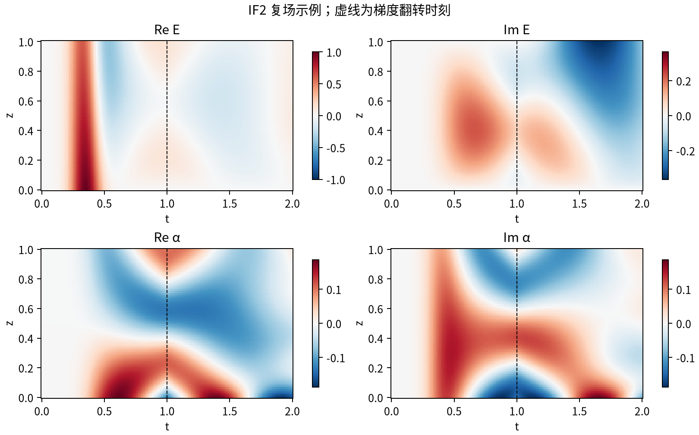

# GEM Solvers：复场、因果推进与可复现验证

**不训练网络，直接求解梯度回波记忆（GEM）的线性场方程。**

本项目把两个独立数值后端整理成可安装的 Python 包：marcher 在时空网格上解局部耦合块系统；IF2 先消去光场的空间传播，再用指数权重推进原子相干性。两者都输出完整的复数 $E(z,t)$ 和 $\alpha(z,t)$，而非只拟合光强或输出一个存储效率。

## 从哪里开始

- **运行算例：** [安装指南](installation.md) → [Python API](api.md)。
- **理解算法：** [模型、离散公式与复杂度](methods.md) → [收敛证据和适用边界](validation.md)。
- **交给自己的 agent：** [可执行安装合同](agents.md)、[llms.txt](llms.txt)、[合并的纯文本说明](llms-full.txt)。
- **与外部求解器对照：** [XMDS2 的输入生成、运行和读取](xmds.md)。

|后端|核心方法|内部存储|可定制范围|
|---|---|---|---|
|marcher|两个坐标方向的梯形离散；沿 $i+j$ 推进|细时空网格上的系数和状态|一般单向输运与线性局部演化；含 GEM / Λ-GEM 协议|
|IF2|Volterra 空间积分；二阶指数拟合；双对角解|当前细空间状态、输出网格、有限缓存|本发行版的线性两能级 GEM|
|XMDS2（可选）|外部代码生成器与独立积分器|由生成程序决定|本项目提供一个可调用的两阶段 GEM 示例|

图中的输入、翻转时刻、参数与生成脚本均在仓库内。该图用于说明接口和场结构，不能单凭视觉证明任意参数下的精度。

## 必须保留的物理合同

本项目使用 $\partial_t\alpha=(\gamma+i\eta\,s(t)(z-L/2))\alpha+igE$。**$\gamma$ 是方程中的有符号系数；物理退相干率 $\Gamma>0$ 对应输入 `gamma=-Gamma`。** 驱动采用原生节点定义，入射复振幅在节点间线性插值，梯度控制在节点间左常值保持。输出坐标不会反过来替代驱动定义。

这是一份数值软件与方法说明，不宣称算法新颖性，不把历史面板的通过结果推广为全域保证。仓库自包含解析测试；历史研究面板的原始参考数据不随发行包分发。[来源与引用](provenance.md)说明这些边界。
