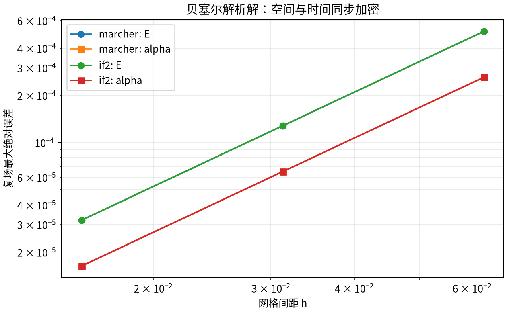

# 验证、成本与局限

## 1. 自包含解析解：可在新仓库独立重跑

令 $g=1,N=2,L=T=1,\eta=\gamma=0$，入射 $u(t)=1$，初态 $\alpha=0$。定义 $x=gNzt$，则

$$
E(z,t)=J_0(2\sqrt{x}),\qquad
\alpha(z,t)=igt\frac{J_1(2\sqrt{x})}{\sqrt{x}},\qquad
\left.\frac{J_1(2\sqrt{x})}{\sqrt{x}}\right|_{x=0}=1.
$$

该解析解可直接代入两条 PDE 和边界条件验证。仓库脚本 `scripts/validate_public.py` 在 $17^2,33^2,65^2$ 网格上计算完整复场最大绝对误差，不依赖任何训练数据或源工程文件。同步加密空间和时间所得记录见 `benchmarks/public_validation.json`。

|后端|网格|E 最大绝对误差|alpha 最大绝对误差|最后一级观测阶 E / alpha|
|---|---:|---:|---:|---:|
|marcher|17 × 17|5.1174e-4|2.6075e-4|—|
|marcher|33 × 33|1.2795e-4|6.5262e-5|—|
|marcher|65 × 65|3.1990e-5|1.6318e-5|1.99995 / 1.99974|
|IF2|17 × 17|5.1174e-4|2.6075e-4|—|
|IF2|33 × 33|1.2795e-4|6.5262e-5|—|
|IF2|65 × 65|3.1990e-5|1.6318e-5|1.99995 / 1.99974|

两后端曲线在这里重合是预期现象：$D=0$ 时 IF2 退化为梯形时间格式。这个算例检查耦合、边界、两复场及二阶收敛，但**不能单独证明高梯度相位处理的优越性**。耗时仅记录为本次运行成本，不以微秒级小算例比较真实性能。

## 2. 测试分别验证哪些层

|证据|检验内容|不能推出|
|---|---|---|
|贝塞尔解析解|两场耦合、零初态、非零入射、二阶收敛|全参数域精度|
|通用制造解与非均匀网格|核心块推进、源项、初态、真实坐标采样|实际器件物理有效性|
|零密度的独立 DOP853 对照|复驱动、局部相位和退相干、事件左右极限|所有高密度耦合情况|
|空间半离散矩阵 ODE 对照|非零耦合下 IF2 时间推进|连续空间误差已消失|
|复线性与边界测试|叠加关系、相位通道、初态传播|与独立参考的绝对精度|
|缓存前后对照|缓存不改变离散运算结果|缓存一定加速|
|真实 XMDS 零耦合算例|编译运行、解析高斯、复场字段、真实坐标|大参数高梯度精度|
|真实 XMDS 有耦合算例|同实际坐标的两复场相对 L2 误差均低于 0.5%|XMDS 是无误差真值、任意问题均低于1%|
|XMDS 失败与覆盖保护|失败日志保留、不覆盖已有结果|任意第三方输入都可安全运行|

运行非 XMDS 测试无需系统编译器；标记为 `xmds` 的测试缺依赖会跳过，不能把跳过算通过。CI 分开报告这两类任务。

## 3. 两复场误差的定义

对于同一组实际采样坐标，分别计算

$$
\epsilon_E=\frac{\|E-E_{ref}\|_2}{\|E_{ref}\|_2},\qquad
\epsilon_\alpha=\frac{\|\alpha-\alpha_{ref}\|_2}{\|\alpha_{ref}\|_2}.
$$

这是复数组的离散 L2 / Frobenius 范数，保留实部和虚部，不是 $|E|$ 的误差。非均匀坐标时它不自动等于连续积分范数；如需物理加权积分必须明确权重并对所有后端一致使用。参考场为零或近零时改用明确的绝对误差，不用任意小分母制造相对指标。

“逐例两场均低于1%”比“平均误差低于1%”严格。下面历史面板使用前者，公开解析表使用最大绝对误差；两种指标不能混为一谈。

## 4. 历史冻结面板：不是本发行版的新测试

以下数字来自源研究工程 exp_123 的24例冻结面板（16个训练划分样本、8个开发划分样本）。这里“训练划分”只是既有数据划分名，**数值求解没有训练过程**。正式64例隐藏测试未解封。原始数据和参考场不随本仓库分发；可核对的源报告路径、摘要和有限汇总见 `benchmarks/historical_summary.json`。

|配置|逐例两场 <1%|训练最大 E / alpha|开发最大 E / alpha|中位 / 最坏秒|
|---|---:|---:|---:|---:|
|IF2 z16 t2|24/24|0.5594% / 0.4189%|0.3532% / 0.2530%|2.970 / 4.018|
|IF2 z32 t2|24/24|0.5059% / 0.2708%|0.3207% / 0.2237%|5.770 / 7.839|
|marcher z32 t2|23/24|0.5191% / 0.3200%|0.4300% / 1.2225%|13.253 / 13.810|

这些倍数依赖当时的原生/输出网格，不能直接移植为新问题的推荐常数。该面板覆盖有限，参考解自身也有精度预算；不构成“所有输入误差均小于1%”的定理。

## 5. 内存与 XMDS 计时口径

exp_124 对每种配置使用独立子进程，在3个代表案例上记录 `ru_maxrss`。IF2 z16 t2 的平均/最大峰值约0.605/0.605 GiB；marcher z16 t2 为6.762/6.763 GiB，z32 t2 为12.860/12.861 GiB。它们包含当时 Python 环境与输入数据的常驻成本，不等于本轻量发行包的最低内存需求。IF2 内存随细空间、输出和缓存增长，**不是数学意义上的恒定内存**。

exp_125 的一个历史 XMDS 配置：生成编译1.947秒，运行9.449秒；改变一个参数后为1.474秒和9.729秒。该配置与上述面板的网格、驱动和输出坐标不同，且当次没有同精度验收。因此**不将这些时间除以 IF2 的2.970秒并宣称公平加速比**。

## 6. 新问题的验收建议

1. 固定方程、符号、原生驱动和真实输出坐标。
2. 分别加密空间与时间，检查 E、alpha 两个复场；高梯度下尤其检查相位。
3. 用更细参考或独立求解器做误差预算，确认驱动插值本身足够精确。
4. 在相同精度门槛下测量每种方法的运行时间和峰值内存，注明编译是否计入。
5. 保存失败、参数、版本和日志；不通过时不降低指标口径来制造成功。

本项目目前没有提供任意输入的自动误差估计器、严谨后验界或自适应精度保证。发布测试通过说明被检查的层工作正常，不能替代具体研究的数值收敛验收。
